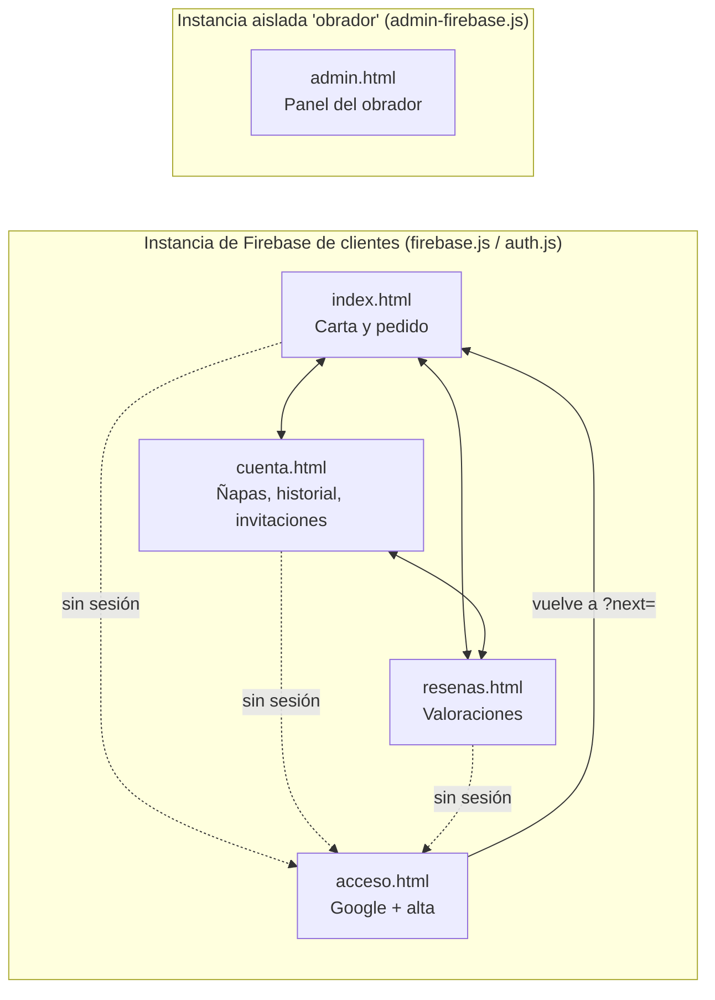
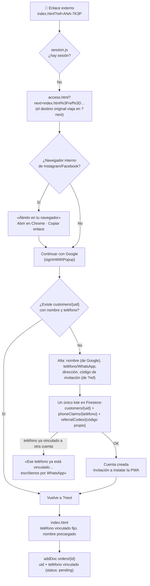
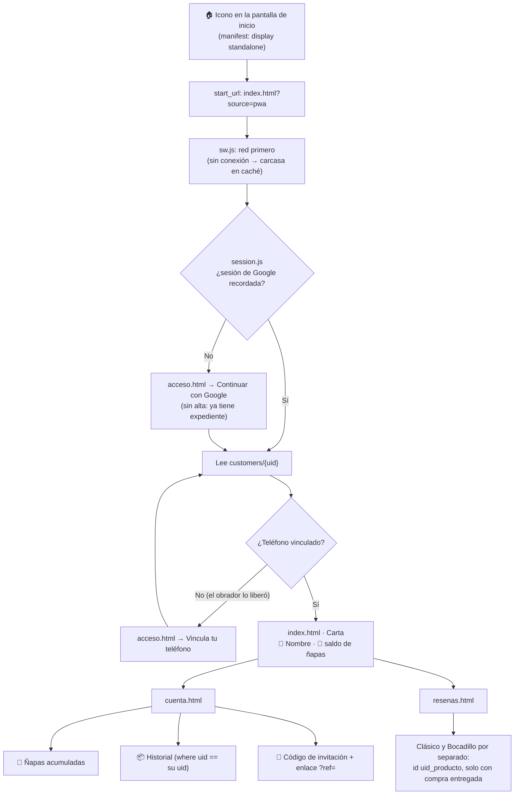
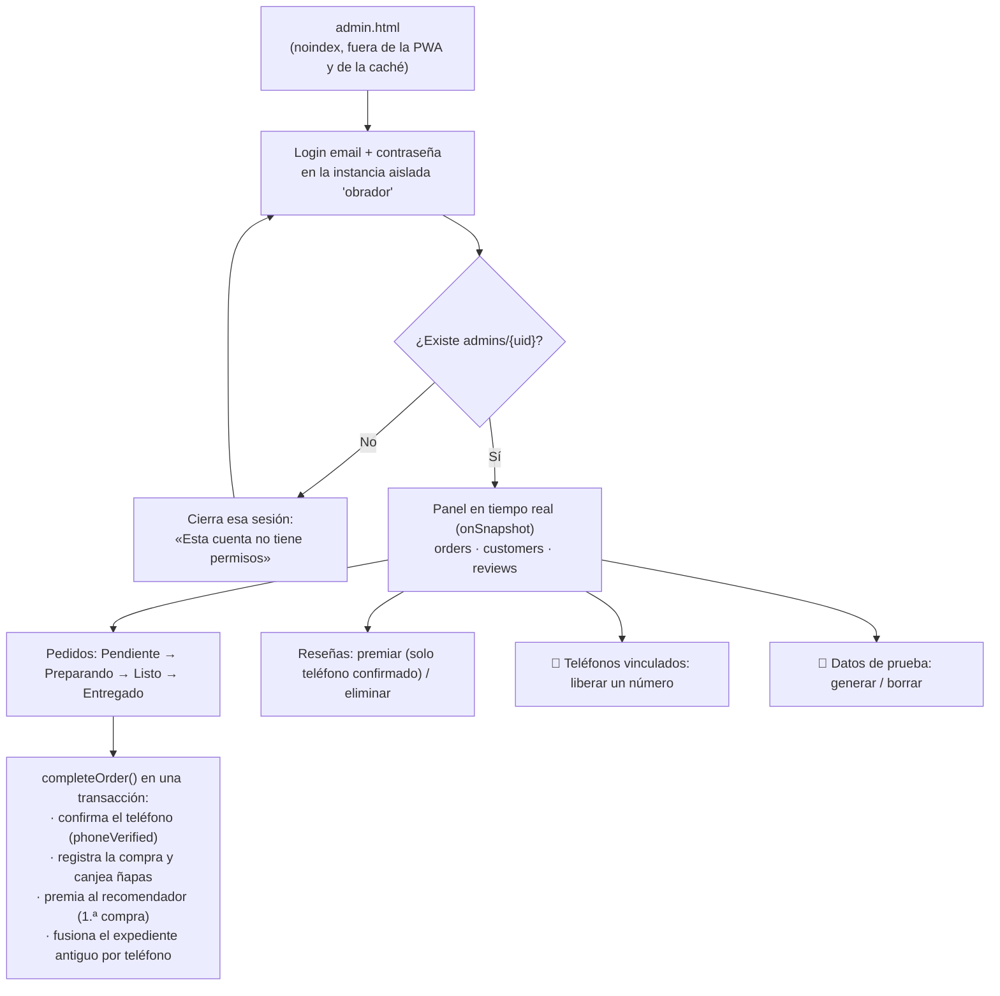

# Pachoncito · Mapa de recorridos de usuario

Este documento describe cómo navega cada perfil por la aplicación, qué archivos intervienen y qué protege cada paso.
Los diagramas usan [Mermaid](https://mermaid.js.org/) (GitHub los dibuja automáticamente); debajo de cada uno hay una tabla con el detalle.

| Perfil | Puerta de entrada | Identidad | Dónde se guarda |
|---|---|---|---|
| Cliente nuevo | Enlace externo (WhatsApp, Instagram, `index.html?ref=ANA-7K3P`) | Cuenta de Google (UID de Firebase) + teléfono vinculado una sola vez | `customers/{uid}`, `phoneClaims/{teléfono}`, `referralCodes/{código}`, `orders/{id}` |
| Cliente recurrente | App instalada (PWA `standalone`) o navegador | Sesión de Google recordada en el dispositivo | Lee su expediente y sus pedidos |
| Administrador | `admin.html` | Email y contraseña en una **instancia de Firebase aislada** + documento `admins/{uid}` | Gestiona todo |
| Pruebas | `?pruebas=1` | Sesión **anónima** real de Firebase + teléfonos de prueba (`+34 600 000 xxx`, `+34 600 023 456`) | Todo marcado con `test: true` |

---

## Mapa general de páginas

| Archivo | Papel en los recorridos |
|---|---|
| `session.js` | Guardia de navegación (`requireCustomer`), lectura del expediente, `safeNext` (anti redirección abierta) |
| `acceso.js` | Google Sign-In (popup), aviso de navegador interno, alta con vinculación del teléfono, invitación a instalar |
| `admin-firebase.js` | Instancia `obrador`: la sesión del panel nunca se mezcla con la de un cliente en el mismo navegador |
| `pwa.js` + `sw.js` + `manifest.json` | App instalable, carcasa sin conexión, invitación de instalación (Android e iOS) |
| `firestore.rules` | La seguridad real: aunque alguien se salte la guardia del navegador, la base de datos rechaza lo que no le corresponde |

---

## 1. Cliente nuevo

| # | Pantalla | Qué ve el cliente | Qué ocurre por debajo | Regla que lo protege |
|---|---|---|---|---|
| 1 | Cualquier página de cliente | Nada (oculta con `.auth-pending`) | `requireCustomer()` no encuentra sesión y redirige con `location.replace` | — |
| 2 | `acceso.html` · Navegador interno | Instrucciones para abrir en Chrome/Safari | Detección por `userAgent` (Google bloquea su login en WebViews) | — |
| 3 | `acceso.html` · Google | Ventana de Google | `signInWithPopup` (el redirect falla en GitHub Pages por ser otro dominio) | — |
| 4 | `acceso.html` · Alta | Nombre, teléfono, dirección, código de invitación | Lote: perfil + cerrojo del teléfono + código propio | `validNewCustomer` + `validClaim`: teléfono libre, email = el de Google, sin ñapas ni compras |
| 5 | `acceso.html` · Bienvenida | Tarjeta «Instala Pachoncito» | Android: `beforeinstallprompt`. iOS: guía de 2 pasos | — |
| 6 | `index.html` | Carta con sus datos | `buildOrder()` + `addDoc(orders)` | `validNewOrder` + uid propio + teléfono = el vinculado |
| 7 | Panel (al entregar) | — | El obrador confirma el teléfono (`phoneVerified`); si vino invitado, su recomendador gana 1 ñapa | Solo el obrador escribe ñapas y verificación |

---

## 2. Cliente recurrente

| Sección | Datos | Origen | Regla |
|---|---|---|---|
| Cabecera de la carta | Nombre y saldo de ñapas | `customers/{uid}` | `allow get: if isOwner(uid)` |
| Mi cuenta | Ñapas, entregas, invitados, teléfono (confirmado o no), código | `customers/{uid}` | Solo lectura para el cliente (salvo nombre y dirección) |
| Historial | Sus pedidos con estado | `orders` filtrado por `uid` | `allow read: if resource.data.uid == request.auth.uid` |
| Reseñas | Formulario + reseñas anónimas | `reviews` + `reviewAuthors` | Pedido propio entregado con ese sabor, una reseña (y 1 ñapa) por pedido, `test` veraz |

---

## 3. Administrador

| Paso | Acción | Detalle |
|---|---|---|
| Acceso | `signInWithEmailAndPassword(adminAuth)` | Instancia `obrador` independiente: entrar como cliente con Google en el mismo navegador no cierra el panel |
| Entregar | Botón «Entregado» | Definitivo. Confirma el teléfono del cliente: es la verificación antifraude |
| Liberar teléfono | Panel → 📱 | Borra el cerrojo y deja la cuenta que lo tenía sin teléfono (tendrá que vincular otro) |
| Seeder | `seeder.js` | Clientes `seed_*` con teléfono y código; pedidos con `buildOrder()` entregados con `completeOrder()` |

---

## Matriz de acceso (resumen de `firestore.rules`)

| Colección | Cliente (su UID) | Cuenta de prueba (anónima) | Administrador | Público |
|---|---|---|---|---|
| `customers/{uid}` | Crear su alta, leer, editar nombre y dirección, re-vincular teléfono si fue liberado | Igual, con `test: true` y teléfonos de prueba | Todo | — |
| `phoneClaims` | Crear el suyo (si está libre), leer el suyo | Puede reutilizar teléfonos de prueba | Todo | — |
| `referralCodes` | Crear el suyo en el alta, consultar uno concreto | Igual | Todo | — |
| `orders` | Crear con su uid y su teléfono; leer los suyos | Igual, con `test: true` | Todo | — |
| `reviews` | Crear (con compra), una por producto | Igual, con `test: true` | Premiar / borrar | Leer |
| `reviewAuthors` | Crear la suya | Crear la suya | Leer / borrar | — |
| `admins` | — | — | Leer la suya | — |

## Parámetros de URL

| Parámetro | Efecto |
|---|---|
| `?next=pagina.html` | Destino tras iniciar sesión (solo páginas internas, validado por `safeNext`) |
| `?ref=ANA-7K3P` | Código de invitación; sobrevive al paso por el muro y se precarga en el alta |
| `?pruebas=1` / `?pruebas=0` | Activa / desactiva el modo pruebas en producción (botón de cuenta de prueba y reseñas de prueba visibles) |
| `?emuladores=1` | Solo en `localhost`: usa los emuladores de Firebase (cuentas de Google ficticias) |
| `?source=pwa` | Marca las aperturas desde la app instalada |
