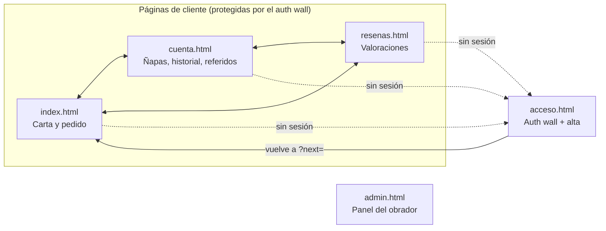
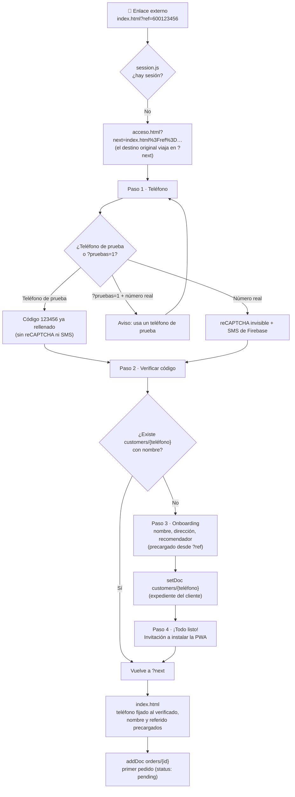
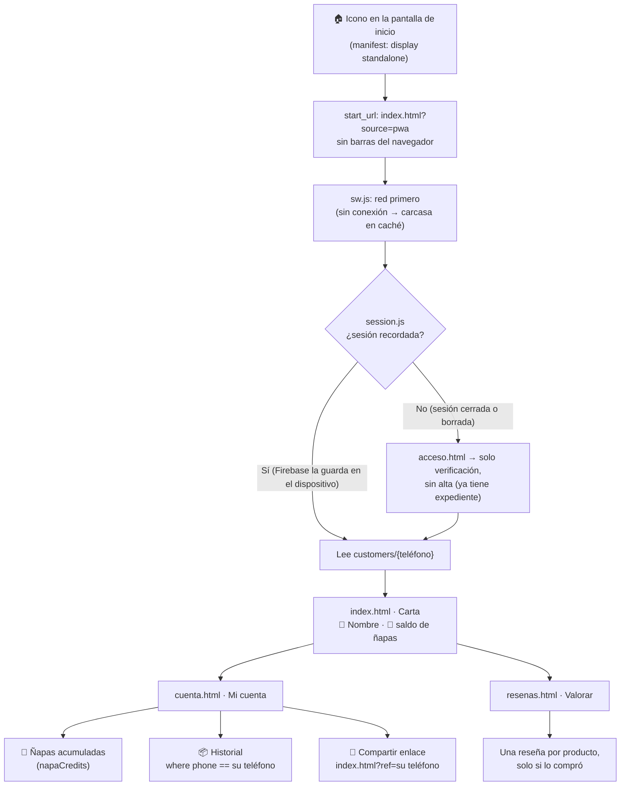
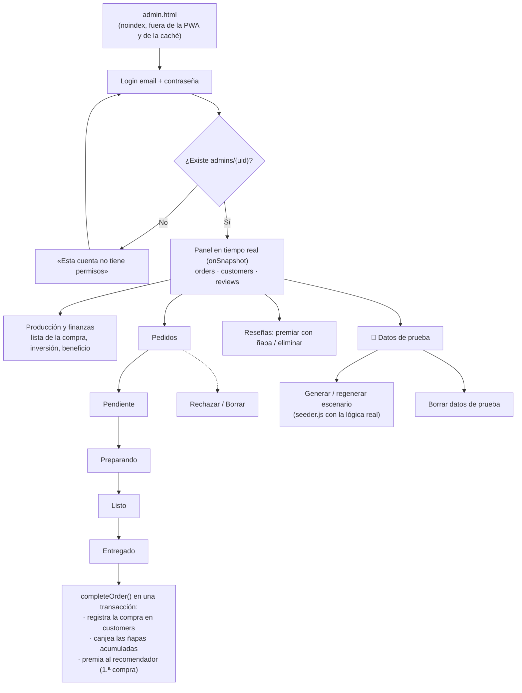

# Pachoncito · Mapa de recorridos de usuario

Este documento describe cómo navega cada perfil por la aplicación, qué archivos intervienen y qué protege cada paso.
Los diagramas usan [Mermaid](https://mermaid.js.org/) (GitHub los dibuja automáticamente); debajo de cada uno hay una tabla con el detalle.

| Perfil | Puerta de entrada | Identidad | Dónde se guarda |
|---|---|---|---|
| Cliente nuevo | Enlace externo (WhatsApp, Instagram, `index.html?ref=…`) | Móvil verificado por SMS (Firebase Auth) | `customers/{teléfono}` + `orders/{id}` |
| Cliente recurrente | App instalada (PWA `standalone`) o navegador | Sesión de Firebase recordada en el dispositivo | Lee su expediente y sus pedidos |
| Administrador | `admin.html` | Email y contraseña (Firebase Auth) + documento `admins/{uid}` | Gestiona todo |
| Pruebas | Cualquiera de las anteriores con `?pruebas=1` | Teléfonos de prueba sin SMS (`+34 600 000 000–006`, `+34 600 023 456`, código `123456`) | Datos marcados como prueba |

---

## Mapa general de páginas



| Archivo | Papel en los recorridos |
|---|---|
| `session.js` | Guardia de navegación (`requireCustomer`), sesión real o de prueba, lectura del expediente, `safeNext` (anti redirección abierta) |
| `acceso.js` | Verificación del móvil, alta del cliente, invitación a instalar y vuelta a la página de origen |
| `pwa.js` + `sw.js` + `manifest.json` | App instalable, carcasa sin conexión, invitación de instalación (Android e iOS) |
| `firestore.rules` | La seguridad real: aunque alguien se salte la guardia del navegador, la base de datos rechaza lo que no le corresponde |

---

## 1. Cliente nuevo



| # | Pantalla | Qué ve el cliente | Qué ocurre por debajo | Regla que lo protege |
|---|---|---|---|---|
| 1 | Cualquier página de cliente | Nada (la página está oculta con `.auth-pending`) | `requireCustomer()` no encuentra sesión y redirige con `location.replace` | — |
| 2 | `acceso.html` · Teléfono | Campo de móvil | Teléfono de prueba → sin SMS. Número real → `signInWithPhoneNumber` | — |
| 3 | `acceso.html` · Código | Código de 6 dígitos | Sesión real de Firebase o sesión de prueba (`localStorage`) | — |
| 4 | `acceso.html` · Alta | Nombre, apellidos, dirección, recomendador | `setDoc(customers/{teléfono})` con `name`, `phone`, `address`, `referralCode?` | `validProfile`: solo su propio teléfono, sin ñapas ni compras |
| 5 | `acceso.html` · Bienvenida | Tarjeta «Instala Pachoncito» | Android: `beforeinstallprompt`. iOS: guía de 2 pasos | — |
| 6 | `index.html` | Carta con sus datos | `buildOrder()` + `addDoc(orders)` | `validNewOrder` + `canActAs(phone)`: solo a su propio teléfono |
| 7 | Panel (más tarde) | — | Al entregar: compra registrada; si vino recomendado, su recomendador gana 1 ñapa | Solo el obrador escribe ñapas |

**Invitación a instalar (paso 5):**

```
┌──────────────────────────────────────────────┐
│ [icono]  📲 Instala Pachoncito            ✕  │   Android / Chrome
│          Pide en un toque desde tu inicio.   │   (beforeinstallprompt)
│          [ Instalar app ]                    │
└──────────────────────────────────────────────┘
┌──────────────────────────────────────────────┐
│ [icono]  📲 Añade Pachoncito a tu inicio  ✕  │   Safari / iOS
│          1. Pulsa Compartir ⎙                │   (guía de 2 pasos)
│          2. «Añadir a pantalla de inicio»    │
└──────────────────────────────────────────────┘
```

Si se descarta con ✕, no vuelve a aparecer en 14 días (salvo justo después del alta). Nunca aparece dentro de la app ya instalada.

---

## 2. Cliente recurrente



| Sección | Datos | Origen | Regla |
|---|---|---|---|
| Cabecera de la carta | Nombre y saldo de ñapas | `customers/{teléfono}` | `allow get: if canActAs(phone)` |
| Mi cuenta · Ñapas | `napaCredits`, `completedOrders`, `referralsCount` | `customers/{teléfono}` | Solo lectura para el cliente |
| Mi cuenta · Historial | Sus pedidos con estado (Pendiente → En preparación → Listo → Entregado) | `orders` filtrado por su teléfono | `allow read: if canActAs(resource.data.phone)` |
| Mi cuenta · Referidos | Enlace `index.html?ref=…` (Web Share API o portapapeles) | — | — |
| Reseñas | Formulario + reseñas anónimas | `reviews` + `reviewAuthors` | Compra previa del producto, 1 por producto, `test` obligatorio y veraz |

---

## 3. Administrador



| Paso | Acción | Detalle |
|---|---|---|
| Acceso | `signInWithEmailAndPassword` | La cuenta se crea en la consola de Firebase y el permiso con el documento `admins/{uid}` (las reglas impiden crearlo desde la web) |
| Pedidos | Botones de estado | «Entregado» es definitivo y ejecuta `completeOrder()` (`orders.js`) |
| Ñapas | Automáticas al entregar | Volumen (1 cada 10 €), referido (1.ª compra del recomendado), feedback (botón en reseñas, 1 por cliente) |
| Seeder | `seeder.js` | Crea pedidos con `buildOrder()` y los entrega con `completeOrder()`: prueba la lógica real, no la simula |
| Pruebas | Etiqueta 🧪 | Pedidos y reseñas de teléfonos de prueba aparecen marcados; «Borrar» solo elimina esos |

---

## Matriz de acceso (resumen de `firestore.rules`)

| Colección | Cliente (su teléfono) | Sesión de prueba (teléfono de prueba) | Administrador | Público |
|---|---|---|---|---|
| `orders` | Crear y leer los suyos | Crear y leer los de prueba | Todo | — |
| `customers` | Crear su alta, leer, editar nombre y dirección | Igual, sobre teléfonos de prueba | Todo | — |
| `reviews` | Crear (con compra), leer | Crear marcadas como prueba | Premiar / borrar | Leer |
| `reviewAuthors` | Crear la suya | Crear la suya | Leer / borrar | — |
| `admins` | — | — | Leer la suya | — |

## Parámetros de URL

| Parámetro | Efecto |
|---|---|
| `?next=pagina.html` | Destino tras autenticarse (solo páginas internas, validado por `safeNext`) |
| `?ref=600123456` | Código de referido; sobrevive al paso por el muro y precarga el alta |
| `?pruebas=1` / `?pruebas=0` | Activa / desactiva el modo pruebas en producción (se recuerda en la pestaña) |
| `?emuladores=1` | Solo en `localhost`: usa los emuladores de Firebase |
| `?source=pwa` | Marca las aperturas desde la app instalada |
